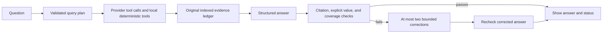

# Bounded answer recovery

The agent keeps its six read-only document functions and one normal provider
answer workflow. The application adds a deterministic plan and a local source
ledger around that workflow. This is a provenance and arithmetic check, not a
second semantic judge.

`query_plan.py` records explicit identifiers, named file scope, required read-only
operations, evidence type, and whether incomplete coverage blocks certainty.
The plan is validated against the active SQLite index. A multipart question may
name more than one document; one named file is not imposed on the other part.
The plan does not decide what a contractual passage means.

`evidence_ledger.py` resolves only exact indexed citations through
`get_evidence`. It retains original passage text or structured cells, document
status, dates, identifiers, explicit status words, and extraction warnings.
Document-list entries are excluded from factual passage evidence. Repeated
citations are deduplicated without merging different rows.

The active answer path checks that each factual citation was retrieved and
resolves to an indexed location. It checks explicit dates, structured IDs, and
currency amounts against cited original content or the question's stated
threshold. BOQ filters and sums use Python, `Decimal`, and original amount cells.
The application never promotes an arbitrary prose interpretation to
"deterministically verified" merely because its citation exists. A model's
unsupported absence statement is not displayed as an established fact when
passages were retrieved.

`recovery.py` records a safe diagnosis and shares a two-attempt budget with the
provider's format, evidence, parse, and tool-use corrections. A missing-evidence
attempt searches bounded question terms or exact identifiers locally. An omitted
citation is linked automatically only when the model's exact phrase occurs in
one unique original evidence record. An explicitly wrong citation is never
silently replaced. If budget remains, one compact final request goes to the
**same selected provider**, with tools disabled and only authentic source
excerpts. Its JSON is parsed and checked again. Failed correction requests are
recorded by exception type only; no provider body or model reasoning is stored.

After the budget is exhausted, unresolved claims stay unverified. The interface
shows original source excerpts for manual review, labeled as excerpts rather
than a verified interpretation. A failed document can still limit exhaustive
or missing-information conclusions. No deterministic parser can prove every
legal or engineering interpretation from unfamiliar natural-language text;
source-linked prose remains subject to human review.
